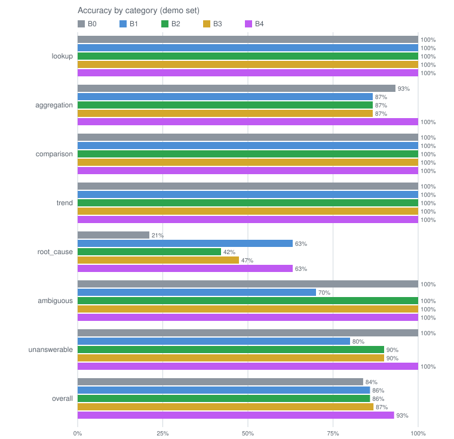
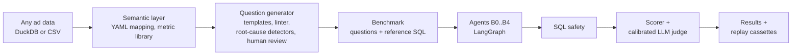
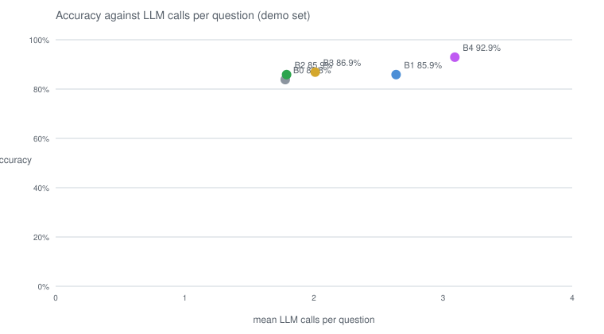

# adsight

A marketing analytics agent that answers questions about ad performance data in plain English, and a benchmark that measures five agent designs against each other.

[](https://github.com/haider268/adsight/actions/workflows/ci.yml)



## Run it locally

```
uv sync
uv run adsight data
uv run adsight bench verify-results --results benchmark/results/haiku-demo-v3
```

The last command replays the published benchmark offline in minutes, with no API key.

Optional: run the agents on a few benchmark questions yourself with a free Groq key. Put
`GROQ_API_KEY=...` in a `.env` file (see `.env.example`), then:

```
uv run adsight bench run --questions-dir benchmark/generated/adsight-demo --arch b4 \
  --model groq:openai/gpt-oss-120b --sample 3
```

## The problem

Text-to-SQL demos are common. Measured ones are rare. Marketing questions mix simple
lookups, rankings, comparisons, trends and "why did this change" questions, and each kind
fails in its own way. A wrong number or an invented cause is worse than no answer, because
someone will act on it. This project measures how often different agent designs get each
kind right, and how often they refuse when they should.

## How it works



**Any ad data.** The input is a DuckDB database or CSV files from any ad platform export.
`adsight data` builds a seeded synthetic dataset with injected incidents for the demo.

**Semantic layer.** A YAML file maps the dataset's own tables and columns to standard ad
concepts: the fact table, measures, the entity hierarchy, attributes and an optional change
log. Every metric (cost per lead, click-through rate and so on) is defined once in a
metric library. `adsight inspect` drafts the mapping.

**Question generator.** Templates produce candidate questions over the semantic layer. A
linter keeps only questions with one clear, stable answer. Root-cause questions come from
logged changes and strict detectors, and detector-based ones wait for human review.

**Benchmark.** Each question has reference SQL, and expected answers are computed from it,
never typed. The same seed gives the same files byte for byte.

**Agents B0..B4.** Five LangGraph designs, from one query and answer up to classify, plan,
self-correct, diagnose and verify. All share one system prompt: the schema card, a compact
description of the data, rebuilt identically for every call.

**SQL safety.** Every query an agent writes is parsed and must be a single read over known
tables, on a read-only connection with no file access, a row cap and a timeout.

**Scorer and judge.** Numbers are matched within 1% or a unit floor, rankings on the first
entity, trends on direction and endpoints. Root-cause answers are graded by an LLM judge
calibrated on hand labels; a regex rule check is reported beside it.

**Results and replay cassettes.** Every run exports its report and a cassette of every model
response it used, so anyone can replay it offline and get the same numbers.

## The five agent designs

| ID | Design | Nodes | Max LLM calls per question |
| --- | --- | --- | --- |
| B0 | One query, one answer | plan -> execute -> answer | 2 |
| B1 | ReAct loop | think -> act -> think ... -> final | 6 |
| B2 | Plan, then execute | plan (1-4 SQL steps) -> execute -> check -> answer | 2 |
| B3 | Plan with self-correction | B2 plus check -> fix -> execute, up to 3 fixes | 5 |
| B4 | Full design | classify -> B3's loop -> diagnose -> synthesize -> verify numbers -> resynthesize once | 7 |

## Results

### Accuracy by category (demo set)

| category | B0 | B1 | B2 | B3 | B4 |
| --- | --- | --- | --- | --- | --- |
| lookup | 15/15 | 15/15 | 15/15 | 15/15 | 15/15 |
| aggregation | 14/15 | 13/15 | 13/15 | 13/15 | 15/15 |
| comparison | 15/15 | 15/15 | 15/15 | 15/15 | 15/15 |
| trend | 15/15 | 15/15 | 15/15 | 15/15 | 15/15 |
| root_cause | 4/19 | 12/19 | 8/19 | 9/19 | 12/19 |
| root_cause (rule check) | 3/19 | 15/19 | 10/19 | 9/19 | 13/19 |
| ambiguous | 10/10 | 7/10 | 10/10 | 10/10 | 10/10 |
| unanswerable | 10/10 | 8/10 | 9/10 | 9/10 | 10/10 |
| overall | 83/99 | 85/99 | 85/99 | 86/99 | 92/99 |

Root-cause questions pass on the judge's verdict; the rule check row is the regex rule
alone, reported for comparison.

### Calls, tokens and cost (demo set)

| architecture | mean LLM calls | mean tokens | total cost |
| --- | --- | --- | --- |
| B0 | 1.778 | 5464.5 | $0.3500 |
| B1 | 2.636 | 11076.9 | $0.7611 |
| B2 | 1.788 | 5926.4 | $0.3951 |
| B3 | 2.01 | 6620.5 | $0.4349 |
| B4 | 3.091 | 10206.8 | $0.4612 |

### Gold set (hand-written questions)

| category | B0 | B4 |
| --- | --- | --- |
| lookup | 14/15 | 14/15 |
| aggregation | 14/15 | 15/15 |
| comparison | 12/15 | 13/15 |
| trend | 14/15 | 13/15 |
| root_cause | 6/20 | 11/20 |
| root_cause (rule check) | 1/20 | 7/20 |
| ambiguous | 10/10 | 10/10 |
| unanswerable | 10/10 | 10/10 |
| overall | 80/100 | 86/100 |

### Variance (repeat runs with different salts)

| run | architecture | passed | accuracy |
| --- | --- | --- | --- |
| var-b4-1-v3 | B4 | 19/20 | 95.0% |
| var-b4-2-v3 | B4 | 19/20 | 95.0% |

### Unanswerable questions answered with made-up numbers

| architecture | fabricated / unanswerable | rate |
| --- | --- | --- |
| B0 | 0/10 | 0.0% |
| B1 | 0/10 | 0.0% |
| B2 | 0/10 | 0.0% |
| B3 | 0/10 | 0.0% |
| B4 | 0/10 | 0.0% |

Fabricated: the agent answered with kind "answer" and at least one value instead of saying
the data cannot answer. The full generated table is in
[docs/results/results.md](docs/results/results.md).



### Findings

- B4 (full design) is the most accurate overall (92.9% vs 83.8% for B0) and the only design
  that answered every lookup, ranking, comparison and trend question correctly.
- "Why" questions separate the designs most: B0 explains 4 of 19, B1 and B4 explain 12.
- Self-correction (B3) adds one root-cause answer over planning alone (B2): 9 vs 8 of 19.
- B1 (ReAct) matches B4 on "why" questions but costs the most and is the weakest at asking
  for clarification (7 of 10) and at refusing (8 of 10).
- No design invented a number on any of the 10 unanswerable questions (0% fabrication).
- The hand-checked gold set agrees: B4 beats B0 there too (86.0% vs 80.0%).
- Run-to-run variance: two repeat runs of B4 on 20 questions both scored 95.0%.

All runs used Claude Haiku 4.5 through the Message Batches API; the full run (735 question
runs, judge included) cost $3.52. To reproduce the table offline:

```
uv run adsight bench verify-results --results benchmark/results/haiku-demo-v3
uv run adsight bench table --results benchmark/results/haiku-demo-v3 --out docs/results
```

Replays of the published v3 run are exact except for a rare DuckDB tie-order effect: one
gold-set query with tied ORDER BY keys renders in a different order in about 2 of 400
executions, so `verify-results` retries a mismatching job up to 3 times. Runs made with
render v4 (the default) break those ties and replay exactly.

## How the benchmark is built

The questions are generated, not hand-written: templates run over the semantic layer, so
the same code builds a benchmark for any mapped dataset. A linter keeps a candidate only if
it passes every rule, in order:

- R1 executes: the reference SQL runs, returns rows and no NULLs.
- R2 volume: every scope has enough conversions, clicks or impressions for a stable answer.
- R3 margin: a ranking's winner leads the runner-up by a clear margin.
- R4 definition: the winner does not change under another common definition of the metric.
- R5 trend: the series is clearly rising or falling, or clearly flat.
- R6 distinct: no two compared values are close enough to be confused.
- R7 coverage: every scope has data on most dates of the period.
- R8 duplicate: no two questions share a template and parameters.

Root-cause questions start from logged material changes (a paused ad, a budget change, an
audience change) and from strict detectors (tracking outages, creative fatigue, month
length, ordinary variation), never from a raw jump in a metric. A large week-to-week swing
is often ordinary noise, so a question built on a jump alone may have no true cause to
find. Questions from detectors start as pending and enter the benchmark only after a
person approves them.

The gold set (100 hand-checked questions, `benchmark/questions.jsonl`) tests the generator
and serves as a validity check on the generated results.

Judge calibration: a hand-labelled set of 30 root-cause answers
(`benchmark/judge/labels.jsonl`); the judge agrees with the labels on 28 of 30
(`benchmark/judge/judge-check-haiku-4-5.json`).

## What was tried and what changed

- Concurrent questions shared one DuckDB connection and could receive each other's results;
  every query now runs on its own cursor.
- The schema card showed a few example entity names, and agents read them as the full list;
  it now lists every name.
- The change log was not described to the agent, so "why" answers ignored it; the card now
  describes its entity and change types and how to use it.
- Requiring both the rule and the judge to pass rejected correct explanations; the
  calibrated judge now decides and the rule check is reported beside it.
- Scoring rejected correct answers on month formats ("May 2026" vs "2026-05") and on entity
  order (the scoped account listed before the winner); entities are now normalised and the
  first entity the question does not itself name is scored.
- Rows from queries with no ORDER BY came back in a different order between runs, which
  broke replays; rows are now sorted when the SQL has no ORDER BY.

## What is generic and what is assumed

Generic:

- Any ad platform export, in any table shape (flat or relational).
- Daily or weekly rows.
- CSV input, loaded into DuckDB.
- Any provider behind the LLM interface (Anthropic, Groq and Gemini ship).
- A second, differently shaped demo dataset (one flat weekly table, no change log) runs with
  no code change.

Assumed:

- Ad performance vocabulary: spend, impressions, clicks, conversions, and an account >
  campaign > ad set > ad style hierarchy.
- Thresholds tuned on the demo data, overridable per dataset in the YAML `tuning:` block.
- Judge labels from the demo data: label 20-30 of your own answers and run
  `bench judge-check` before trusting the judge on another dataset.
- Root-cause detectors work best with a change log.
- English column names.
- DuckDB.

## Limitations and production notes

- The data is synthetic: seeded, with injected incidents.
- The published run used one paid model.
- The judge is an LLM; it agrees with hand labels on 28 of 30.
- Categories are small (10-20 questions), so one question moves a category by 5-10 points.
- There is no web demo yet.

## Tech stack

Python 3.11+, uv, DuckDB, sqlglot, LangGraph, LangChain (Groq, Gemini connectors), the
Anthropic SDK (Message Batches), Pydantic, Typer. GitHub Actions runs CI and the scheduled
benchmark ticks.

Groq and Gemini free tiers work for small runs. Their limits change, so check them before a
large run.

## License

MIT. See [LICENSE](LICENSE).
